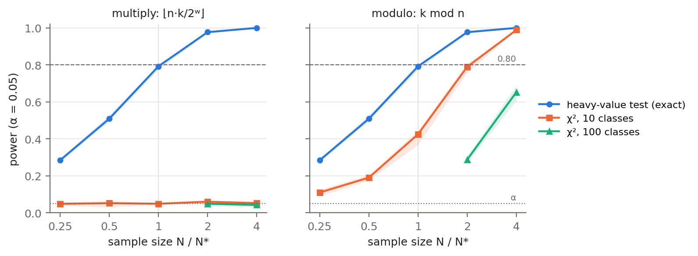
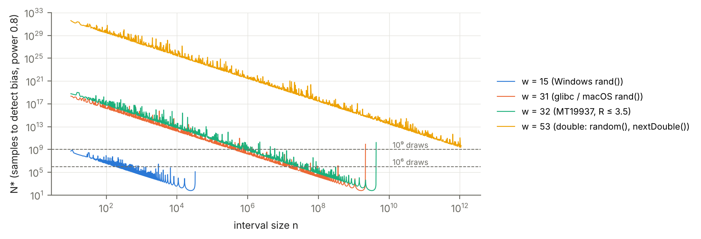

# bounded-int-bias

Bias of generating uniform integers in a range {0, …, n−1}: exact theory, statistical tests, and real data from
several languages and environments (C, C++, R, Python, Java, JavaScript, Excel; Linux, macOS, Windows).

Authors: Valentina Astafi, Alexei Leahu — Technical University of Moldova.
Part of the doctoral thesis *Comparative statistical analysis of pseudorandom number generation algorithms used in
various computer applications* (Ch. II, 2.4–2.5); the code will be integrated into StatPRNG.

## In short

With r = 2^w mod n, the methods `floor(n·U)` and `k mod n` give exactly r "heavy" values. The probability gap is
r(n−r)/(n·2^w), and the heavy-value test detects the bias with approximately

N* ≈ (z₁₋α/₂ + z₁₋β)² · 4^w / (r(n−r))

samples. Details and the status of every claim: [`docs/METHODOLOGY.md`](docs/METHODOLOGY.md).

## Results

### R `sample()`, n = 1.5·2^30, 100,000 values (source `linux-cloud`)

| Method | heavy-value test, N = 1,000 | χ² (1,000 classes), N = 100,000 |
|---|---|---|
| `Rounding` (R ≤ 3.5) | p ≈ 10⁻⁵ (detected) | p = 0.93 (not detected) |
| `Rejection` (R ≥ 3.6) | p = 0.11 | p = 0.53 |

### All languages, n = 1.5·2^30, N = 100,000 (`results/linux-cloud/summary.csv`)

| Function | Bits | N* (formula) | p, heavy-value test | Conclusion |
|---|---|---|---|---|
| C `rand() % n` (glibc) | 31 | 63 | ≈ 0 | bias detected |
| R `sample()`, old (`Rounding`) | 32 | 251 | ≈ 0 | bias detected |
| R `sample()`, new (`Rejection`) | — | — | 0.42 | correct |
| Java `nextInt(n)` | — | — | 0.43 | correct |
| Python `randrange`, numpy | — | — | 0.27; 0.13 | correct |
| JS `crypto.randomInt` | — | — | 0.67 | correct |
| Python `int(random()*n)`, Java `(long)(nextDouble()*n)` | 53 | 1.1·10¹⁵ | 0.36; 0.36 | bias exists, practically undetectable |
| JS `Math.floor(Math.random()*n)` | 52 | 2.8·10¹⁴ | 0.92 | bias exists, practically undetectable |

The same conclusions hold on macOS and Windows (`results/mac-va/summary.csv`, `results/windows-va/summary.csv`).

Multiple testing (`python3 scripts/multiple_testing.py` -> `results/multiple_testing.csv`): over all 80 tests of
the audit, Holm and Benjamini-Hochberg at 0.05 reject the same 9, all with p < 10^-15, and for the heavy-value test
the decision matches the prediction (biased function and N >= N*) in 40 of 40 cases.

### Reproducibility on three systems, same seed (`results/reproducibility_*.csv`)

| Function | Linux x86-64 (glibc, libstdc++) | macOS arm64 (libc, libc++) | Windows x86-64, Pentium (MinGW: libstdc++) |
|---|---|---|---|
| C++ `uniform_int_distribution` + `mt19937` | reference | **differs from the first value** | identical to Linux |
| C `rand()` | `RAND_MAX` = 2^31−1 | `RAND_MAX` = 2^31−1, different algorithm | **`RAND_MAX` = 32,767** |
| R, Python (random, numpy), Java | reference | identical | identical |

The differences come from the standard library in use, not from the operating system or the processor: Windows with
libstdc++ matches Linux, and R, Python and Java produce the same 100,000 values on x86 and on ARM.

On Windows, `rand() % n` is strongly biased already at n = 20,000 (N* ≈ 91; p ≈ 0), and for n = 1.5·2^30 it only
produces values below 32,768: almost all of the requested range never occurs.

### Practical effect (E6): a raffle among m participants with `rand() % m`

`results/linux-cloud/practical/raffle.csv`; exact model of the Windows `rand()`, validated on all 100,000 values in
`results/windows-va`.

| m | Windows (15 bits) | Linux/macOS (31 bits) |
|---|---|---|
| 1,000 | the first 768 participants have 3.1% higher odds | difference ≈ 0 |
| 20,000 | the first 12,768 participants have **twice** the odds; 64% of participants take 78% of the wins | ratio 1.000009 |
| 50,000 | **17,232 participants (34%) can never win** | ratio 1.000023 |

### Power of the tests (`results/linux-cloud/power/power.csv`)



At N = 4·N* (α = 0.05, 400 replications, mean over 4 values of n):

| Method | heavy-value test | χ² B=10 | χ² B=100 | χ² B=1,000 | χ² B=10,000 |
|---|---|---|---|---|---|
| `mult` (`floor(n·U)`) | 1.00 | ≈ 0.05 | ≈ 0.04 | ≈ 0.05 | ≈ 0.05 |
| `mod` (`k mod n`) | 1.00 | ≈ 0.99 | ≈ 0.65 | ≈ 0.18 | ≈ 0.08 |

For `mult`, equal-class χ² stays at the type I error level whatever the number of classes. For `mod`, the bias is
concentrated at the start of the range and χ² with few classes detects it.

### Where the bias is detectable



### Standard battery (E7): TestU01 SmallCrush, n = 1.5·2^30, MT19937 seed 2026 (`results/mac-va/testu01`)

| Generator | u = y / n (direct) | u = (y + V) / n (dithered) |
|---|---|---|
| raw MT19937 (control) | 0 of 15 failed | — |
| `rejection` (correct) | **8 failed** (artefact) | 0 failed |
| `mult` (`floor(n·U)`) | 8 failed | 9 failed |
| `mod` (`k mod n`) | 12 failed | 7 failed |
| `mult`, 53-bit source (Python `random()`) | — | 0 failed |
| `mod`, 53-bit source | — | 0 failed |

Feeding y / n directly makes even the correct conversion fail: y / n has only ~30.6 bits and TestU01 reads 32, so
the bit-level tests see the lattice, not the bias. With dithering (V uniform from the next output) the correct
conversion passes and both biased conversions fail. `mod` fails tests on the coarse distribution (MaxOft,
RandomWalk1); `mult` fails only tests that read low-order bits (Gap, SimpPoker, CouponCollector, HammingIndep,
WeightDistrib), because its heavy values repeat with period 3 (y = ⌊3k/8⌋) and equal-width classes average them out.
With a 53-bit source both conversions pass, as predicted by N* ≈ 1.1·10¹⁵.

### Excel (E5): `RANDBETWEEN` and `INT(RAND()*n)`, n = 1.5·2^30 (`results/excel-*-va`)

`RAND()` returns k / 2^53 with k uniform on both systems (exact values stored in the `.xlsx` file;
`scripts/excel_rand_bits.py`), so N* ≈ 1.1·10^15 and the bias cannot be seen with 10^5 values.
Two independent samples of 100,000 values per function and system; p-values of the heavy-value test:

| | `INT(RAND()*n)` | `RANDBETWEEN` |
|---|---|---|
| Excel for Mac 16.114.4 (macOS 27.2, arm64) | 0.023 / 0.99 | 0.95 / 0.33 |
| Excel 2019 16.0.13001 (Windows 10, x86-64) | 0.85 / 0.32 | 0.40 / 0.78 |

Two of the 16 Excel p-values (heavy-value test and χ² with 10 classes) are below 0.05; the independent second
samples of the same cases give 0.99 and 0.25, as expected for chance fluctuations when N/N* ≈ 10^-10.

### Not yet run

- E7: TestU01 Crush (several hours; `sh scripts/run_testu01.sh <source-id> crush`).

## Layout

```
src/theory/bias.py          exact formulas (heavy values, gap, N*)
src/simulation/power.py     power of the tests by simulation
src/analyze_sample.py       analysis of a file of values from ANY source
src/languages/<language>/   generators: C, C++, R, Python, Java, JavaScript; Excel template and protocol
src/practical/              E6: raffle with rand() % m; exact model of the Windows rand()
src/testu01/                E7: TestU01 harness
scripts/                    run_local.sh / .bat, run_testu01.sh, analyze_all.py, compare_sources.py, import_excel_csv.py,
                            excel_rand_bits.py, summarize_testu01.py, multiple_testing.py, make_figures.py, check_repo.py
results/<source-id>/        data and results, one folder per source (see results/README.md)
figures/                    article figures (PDF + PNG)
tests/                      exhaustive checks of the theory
docs/                       methodology, literature, bibliography
```

## How to reproduce

Requirements: Python 3.9+ (on macOS and Linux the command is `python3`; on Windows `py` or `python`), a C/C++
compiler, and optionally R, Java 17+ and Node.js. Run every command from the repository root. Lines starting with
`#` are comments; copy only the commands.

```bash
# 1. Python packages
python3 -m pip install -r requirements.txt

# 2. Theory: exhaustive checks for w = 6, 8, 10
python3 -m pytest -q tests

# 3. Generate samples with every language found on this machine (pick a source id, e.g. mac-yourname)
sh scripts/run_local.sh mac-yourname
#    on Windows instead:  scripts\run_local.bat windows-yourname

# 4. Analyse the samples -> results/<source-id>/summary.csv
python3 scripts/analyze_all.py mac-yourname

# 5. Same-seed reproducibility between two sources -> results/reproducibility_<a>_vs_<b>.csv
python3 scripts/compare_sources.py linux-cloud mac-yourname

# 6. Power of the tests by simulation (a few minutes) and the raffle example
python3 src/simulation/power.py --out results/mac-yourname/power --bins 10 100 1000 10000
python3 src/practical/raffle.py results/mac-yourname/practical

# 7. Figures (read results/linux-cloud/power/power.csv) -> figures/
python3 scripts/make_figures.py

# 8. Multiple-testing correction over every source -> results/multiple_testing.csv
python3 scripts/multiple_testing.py

# 9. Check that every expected result file is present and nothing stray is tracked
python3 scripts/check_repo.py
```

### TestU01 (E7, macOS or Linux)

```bash
# downloads and builds TestU01 in ~/testu01 once, then runs SmallCrush on 9 generators (a few minutes)
sh scripts/run_testu01.sh mac-yourname
python3 scripts/summarize_testu01.py mac-yourname
```

### Excel (E5, Windows or macOS)

1. Open `src/languages/excel/E5_template.xlsx` in Excel. It holds 100,000 rows of `RANDBETWEEN`, `INT(RAND()*n)`
   and `RAND()`.
2. Save it as **CSV** (`E5.csv`) and also save the workbook itself (`.xlsx`); both keep the generated values.
3. Then:

```bash
python3 scripts/import_excel_csv.py path/to/E5.csv excel-mac-yourname
python3 scripts/excel_rand_bits.py path/to/E5_template.xlsx excel-mac-yourname
python3 scripts/analyze_all.py excel-mac-yourname
```

4. Copy `src/languages/excel/environment_template.json` to `results/excel-mac-yourname/environment.json` and fill
   in the Excel version (Excel → About Excel on macOS; File → Account → About Excel on Windows).

Details: `src/languages/excel/PROTOCOL.md`. Rules for results folders: `results/README.md`.

## License

Code: MIT. Data and documentation: CC BY 4.0.
